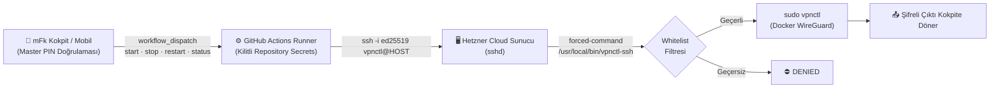

<div align="center">

# 🛡️ mFk // CYBERSHIELD

### Sıfır Saldırı Yüzeyli, Açık Portsuz Kişisel GitOps WireGuard Komuta Merkezi

**mFk Games** için özel olarak geliştirilmiş askeri düzeyde kişisel VPN savunma hattı.  
İnternete açık web paneli yok, dinleyen admin portu yok, yetkisiz shell erişimi yok.

[](https://github.com/mFkGames/mfkvpn.github.io)
[](https://github.com/mFkGames/mfkvpn.github.io)
[](https://github.com/mFkGames/mfkvpn.github.io)
[](https://github.com/mFkGames/mfkvpn.github.io)
[](LICENSE)

</div>

---

## ⚡ Neden Farklı?

Klasik VPN panelleri (wg-easy vb.) internete açık bir web arayüzü bırakır. Bu arayüz doğrudan port taramalarına, brute-force saldırılarına ve açık riski taşır.

**mFk Cybershield ise sıfır saldırı yüzeyi prensibiyle çalışır:**
* **Sıfır Açık Panel:** Sunucuda web sunucusu (Nginx/Apache/Node vb.) çalışmaz. Yalnızca UDP 51820 ve SSH açıktır.
* **En Az Yetki (Least Privilege):** İşlemler `root` yerine kısıtlı `vpnctl` kullanıcısı ile yürütülür.
* **Forced-Command Zırhı:** SSH anahtarı çalınsa dahi `authorized_keys` içindeki kilit nedeniyle yalnızca 4 adet whitelist komut çalışabilir, terminal/shell açılamaz.
* **Sıfır Bilgi İstemci (Zero-Knowledge):** WireGuard anahtar çiftleri doğrudan tarayıcınızda üretilir (Web Crypto X25519). Özel anahtar sunucuya veya dışarıya asla iletilmez.
* **Şifrelenmiş Kriptex Kasası:** GitHub erişim token'ı koda açık metin olarak yazılmaz; kriptex şifresiyle bellekte çözülür.

---

## 🧭 Sistem Mimarisi



---

## 🚀 Komuta Kokpiti Kullanımı

1. **Giriş:** `index.html` sayfasını tarayıcınızda açın.
2. **Kimlik Doğrulama:** Master PIN ekranına parolanızı (`mfk2026`) girin.
3. **Yönetim:**
   * **[Başlat]:** WireGuard konteynerini ayağa kaldırır ve kayıtlı cihazları tünele bağlar.
   * **[Durdur]:** Acil durum tünel kesicidir (Kill-Switch). Tüm cihazların bağlantısını anında keser.
   * **[Yeniden Başlat]:** Tüneli 2 saniyede yenileyip bağlantıları tazeler.
   * **[Durumu Tara]:** Anlık çalışma süresi, bağlı peer sayısı ve el sıkışma sürelerini çeker.
   * **[+ Yeni Cihaz]:** Telefon veya bilgisayar için tarayıcıda tek tıkla QR kod ve `.conf` üretir.

---

## 📁 Dizin Yapısı

```
mfkvpn/
├── index.html                   # mFk // CYBERSHIELD Özel Siber Komuta Kokpiti
├── LICENSE                      # mFk Games Özel Mülkiyet Lisansı
├── README.md                    # Sistem Dokümantasyonu
├── .github/
│   └── workflows/
│       └── vpn-control.yml      # Otomatik GitOps Orkestrasyonu
└── server/
    ├── vpnctl                   # Sunucu yetkili yönetim betiği
    ├── vpnctl-ssh               # Regex doğrulamalı SSH forced-command filtresi
    └── sudoers-vpnctl           # Kısıtlı sudo izin kuralı
```

---

## 🔐 Güvenlik Katmanları

| Katman | Koruma Önlemi |
|---|---|
| **Erişim** | Master PIN korumalı siber kilit ekranı & kaynak kodu koruma caydırıcısı |
| **Orkestrasyon** | GitHub 2FA korumalı Repository Secrets (`HOST`, `USERNAME`, `SSH_KEY`, `SSH_PORT`) |
| **Ağ Taşıma** | Tek amaçlı `ed25519` SSH anahtarı + `StrictHostKeyChecking` |
| **Sunucu Girişi** | `restrict,command="/usr/local/bin/vpnctl-ssh"` forced-command filtresi |
| **Konteyner** | Kernel-level WireGuard `ChaCha20-Poly1305` tüneli |

---

<div align="center">

**PROPRIETARY & CONFIDENTIAL**  
Copyright © 2026 **mFk Games** (mFk). Tüm hakları saklıdır.  
*İzinsiz kopyalama, dağıtma veya tersine mühendislik yapılması yasaktır.*

</div>
