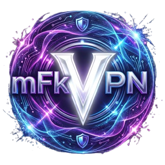

# 🌐 mFkVpN

### Next-Gen Personal WireGuard Dashboard & Stealth Control Portal

---

### 🛡️ TR • Genel Bakış

**mFkVpN**, kişisel kullanım için tasarlanmış, yüksek güvenlikli ve modern bir WireGuard yönetim arayüzüdür.

* **Sıfır Günlük (Zero-Logs):** Hiçbir kullanıcı etkinliği veya DNS sorgusu diske kaydedilmez; tüm süreçler RAM üzerinden işlenir.
* **Uçtan Uca Şifreleme:** İstemci tarafı X25519 asimetrik anahtar üretimi ile özel anahtarlar tarayıcı dışına çıkmaz.
* **Modern Mobil Deneyim:** PWA uyumlu, bağımsız çalışan ve tam ekran mobil erişim desteği.
* **Gelişmiş Gizlilik:** Ağ sızıntılarını önleyen entegre tünelleme ve dinamik parametre koruması.

---

### 🌐 EN • Overview

**mFkVpN** is a high-security, next-generation WireGuard dashboard and stealth portal engineered for private operations.

* **Zero-Logs Commitment:** No user activity, network traffic, or DNS queries are stored on disk.
* **Client-Side Cryptography:** End-to-end asymmetric key generation (X25519); private keys never leave your device.
* **PWA & Mobile Ready:** Responsive, standalone application experience for mobile devices.
* **Strict Leak Prevention:** Comprehensive tunnel configuration designed to prevent DNS and IP leaks.

---

**PROPRIETARY & CONFIDENTIAL • TESCİLLİ VE GİZLİDİR**  
Copyright © 2026 **mFk Games**. All rights reserved / Tüm hakları saklıdır.  
*Refer to [LICENSE](LICENSE) for terms.*

