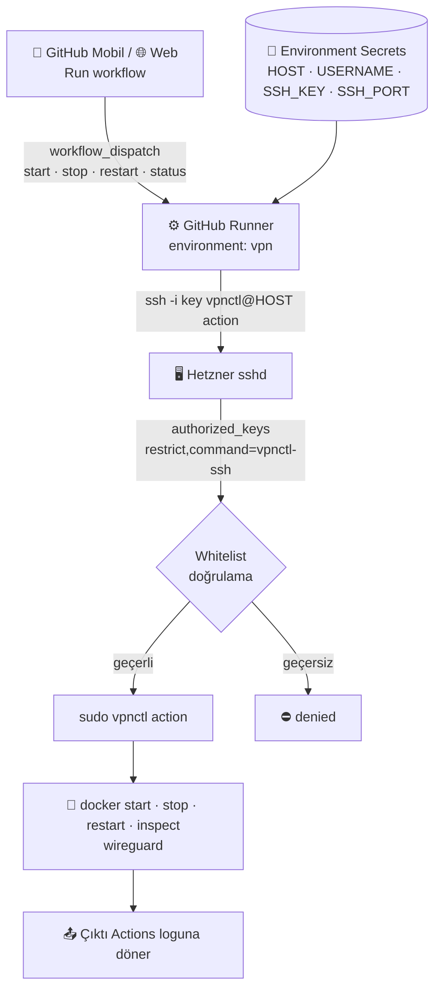
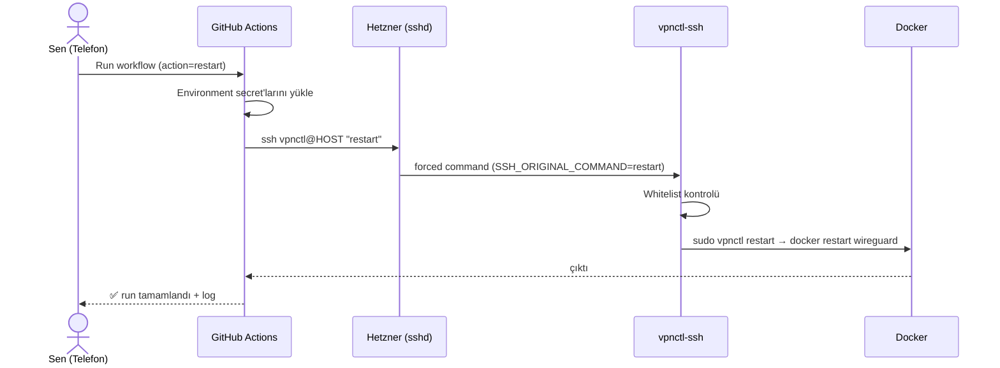

<div align="center">

# 🛡️ mfkvpn

### GitHub'ı kontrol paneline çeviren, açık yönetim portu olmayan WireGuard GitOps sistemi

Telefondan tek dokunuşla VPN sunucunu **aç · kapat · yeniden başlat · sorgula**.
Web paneli yok, açık admin portu yok, root yok.


[Hızlı Başlangıç](#-hızlı-başlangıç) · [Mimari](#-mimari) · [Güvenlik](#-güvenlik-modeli) · [Kullanım](#-kullanım) · [Yol Haritası](#-yol-haritası) · [SSS](#-sss)

</div>

---

## 📑 İçindekiler

1. [Neden mfkvpn?](#-neden-mfkvpn)
2. [Rakiplerle karşılaştırma](#-rakiplerle-karşılaştırma)
3. [Özellikler ve durum](#-özellikler-ve-durum)
4. [Mimari](#-mimari)
5. [Güvenlik modeli](#-güvenlik-modeli)
6. [Gereksinimler](#-gereksinimler)
7. [Hızlı başlangıç](#-hızlı-başlangıç)
8. [Kod: sunucu betikleri](#-kod-sunucu-betikleri)
9. [Kod: workflow](#-kod-workflow)
10. [Kullanım](#-kullanım)
11. [Komut referansı](#-komut-referansı)
12. [Sertleştirme kontrol listesi](#-sertleştirme-kontrol-listesi)
13. [Yol haritası](#-yol-haritası)
14. [Sorun giderme](#-sorun-giderme)
15. [SSS](#-sss)
16. [Repo yapısı](#-repo-yapısı)

---

## 🎯 Neden mfkvpn?

Klasik self-hosted VPN panelleri (web arayüzü olanlar) internete açık bir yönetim portu bırakır. Bu port saldırı yüzeyidir.

**mfkvpn tersini yapar:** yönetim arayüzü GitHub'dır, sunucuda dinleyen ekstra bir servis yoktur. Tek giriş kapısı kısıtlanmış bir SSH anahtarıdır ve o anahtar yalnızca 4 komut çalıştırabilir.

| Prensip | Uygulama |
|---|---|
| **Sıfır açık panel** | Web UI yok, ek port yok |
| **En az yetki** | `vpnctl` kullanıcısı, root yok, `docker` grubu yok |
| **Tek amaçlı anahtar** | `restrict,command=` ile kilitli SSH anahtarı |
| **Denetlenebilirlik** | Her işlem Actions logunda: kim, ne zaman, ne |
| **Tekrarlanabilirlik** | Her şey repoda, sunucu betikle yeniden kurulur |

---

## ⚔️ Rakiplerle karşılaştırma

| Özellik | **mfkvpn** | wg-easy | PiVPN | Firezone | Tailscale |
|---|:---:|:---:|:---:|:---:|:---:|
| Kendi sunucunda barındırma | ✅ | ✅ | ✅ | ✅ | ⚠️ kontrol düzlemi bulutta |
| Açık yönetim portu gerekmez | ✅ | ❌ web UI portu | ✅ | ❌ | ✅ |
| Mobilden tek dokunuşla aç/kapat | ✅ GitHub uygulaması | ⚠️ tarayıcı | ❌ | ⚠️ | ⚠️ |
| Kısıtlı yetkili kullanıcı (root yok) | ✅ | ❌ | ❌ | ❌ | n/a |
| Komut whitelist'i (forced command) | ✅ | ❌ | ❌ | ❌ | n/a |
| Yerleşik denetim izi | ✅ Actions logu | ❌ | ❌ | ✅ | ✅ |
| Altyapı kod olarak (IaC) | ✅ | ⚠️ | ❌ | ⚠️ | ⚠️ |
| Ek ücret / ek hesap | ✅ yok | ✅ | ✅ | ⚠️ plan | ⚠️ plan |
| Web arayüzü ile peer yönetimi | 🚧 GitHub üzerinden (Faz 2) | ✅ | ❌ CLI | ✅ | ✅ |
| QR kod ile peer dağıtımı | 🚧 Faz 2 | ✅ | ✅ | ✅ | ✅ |
| SSO / kullanıcı yönetimi | ❌ kapsam dışı | ❌ | ❌ | ✅ | ✅ |

> ✅ var · 🚧 planlı · ⚠️ kısmi / koşullu · ❌ yok. Karşılaştırma genel özelliklere dayanır, projeler zamanla değişir.

---

## ✨ Özellikler ve durum

| Durum | Özellik | Açıklama |
|:---:|---|---|
| ✅ | `start` / `stop` / `restart` | WireGuard konteynerini GitHub'dan yönet |
| ✅ | `status` | Durum, başlangıç zamanı, peer sayısı |
| ✅ | Kısıtlı kullanıcı | `vpnctl`, şifresiz, yalnızca 4 sudo komutu |
| ✅ | SSH forced-command | Anahtar çalınsa bile keyfi komut çalışmaz |
| ✅ | Environment secret'ları | Repo yerine `vpn` environment içinde |
| ✅ | Eşzamanlılık kilidi | Aynı anda tek işlem |
| ✅ | Üçüncü parti action yok | Düz `ssh`, tedarik zinciri riski yok |
| 🚧 | Peer ekle / sil / listele | Config loga düşmez, `age` ile şifrelenir |
| 🚧 | QR kod üretimi | Mobil peer kurulumu için |
| 🚧 | Health-check + otomatik restart | 15 dk'lık zamanlanmış kontrol |
| 🚧 | Bildirim | ntfy / Telegram |
| 🚧 | Auto-stop | 30 / 60 / 120 dk sonra otomatik kapanma |
| 🚧 | Anahtar rotasyonu | Tek tıkla yeni SSH anahtarı |
| 🚧 | Onay kapısı | `stop` / `restart` için environment reviewer |
| 🚧 | `install.sh` | Sıfırdan tek komutla sunucu kurulumu |
| 🚧 | Şifreli yedek | Peer config'lerinin `age` ile yedeği |

---

## 🧭 Mimari



### Zaman akışı



---

## 🔐 Güvenlik modeli

### Katmanlar

| # | Katman | Önlem |
|:-:|---|---|
| 1 | Hesap | GitHub 2FA (passkey / authenticator) zorunlu |
| 2 | Repo | Private, yalnızca sen collaborator |
| 3 | Secret | Repo yerine `vpn` Environment içinde |
| 4 | Workflow | `permissions: {}`, `timeout-minutes`, `concurrency` |
| 5 | Taşıma | `StrictHostKeyChecking=yes`, `known_hosts` sabitleme |
| 6 | Anahtar | Bu işe özel `ed25519`, `restrict` + `command=` |
| 7 | Girdi | `SSH_ORIGINAL_COMMAND` whitelist'i |
| 8 | Yetki | `sudoers`: yalnızca 4 tam komut yolu |
| 9 | Kullanıcı | `vpnctl`: şifresiz, `docker` grubunda değil |

### Tehdit senaryoları

| Senaryo | Sonuç |
|---|---|
| `SSH_KEY` sızdı | Saldırgan yalnızca `start/stop/restart/status` çalıştırabilir. Shell, tünel, dosya erişimi yok |
| GitHub hesabı ele geçirildi | 2FA yoksa risk yüksek. 2FA + environment reviewer ile azaltılır |
| Workflow dosyası değiştirildi | Sunucu tarafı whitelist yine geçersiz komutu reddeder |
| Üçüncü parti action ele geçirildi | Kullanılmıyor, düz `ssh` var |
| Log'dan bilgi sızması | Secret'lar maskelenir, `status` çıktısında hassas veri yok |

> **Kural:** Sunucu betikleri repoda versiyonlanır ama sunucuya **elle, root ile** kurulur. Workflow kendi yetkisini yükseltemez.

---

## 📋 Gereksinimler

- Hetzner (veya herhangi bir) Linux sunucu, SSH erişimi
- Docker kurulu, çalışan bir WireGuard konteyneri (adı `wireguard` varsayılır)
- GitHub hesabı (2FA açık) ve private repo
- Yerel makinede `ssh` ve `ssh-keygen` (Windows 10/11 CMD'de dahili gelir)

---

## 🚀 Hızlı başlangıç

### 1. Sunucuda kullanıcı ve betikleri kur (root)

```bash
adduser --disabled-password --gecos "" vpnctl

install -m 755 -o root -g root server/vpnctl         /usr/local/bin/vpnctl
install -m 755 -o root -g root server/vpnctl-ssh     /usr/local/bin/vpnctl-ssh
install -m 440 -o root -g root server/sudoers-vpnctl /etc/sudoers.d/vpnctl
visudo -cf /etc/sudoers.d/vpnctl
```

### 2. Anahtar çifti üret

Linux / macOS:

```bash
ssh-keygen -t ed25519 -f ~/.ssh/vpnctl_gh -C "github-actions-vpnctl" -N ""
cat ~/.ssh/vpnctl_gh.pub
```

Windows CMD:

```bat
ssh-keygen -t ed25519 -f %USERPROFILE%\.ssh\vpnctl_gh -C "github-actions-vpnctl" -N ""
type %USERPROFILE%\.ssh\vpnctl_gh.pub
```

### 3. Public key'i sunucuya kilitli olarak ekle (root)

```bash
install -d -m 700 -o vpnctl -g vpnctl /home/vpnctl/.ssh
echo 'restrict,command="/usr/local/bin/vpnctl-ssh" <PUBKEY>' > /home/vpnctl/.ssh/authorized_keys
chown vpnctl:vpnctl /home/vpnctl/.ssh/authorized_keys
chmod 600 /home/vpnctl/.ssh/authorized_keys
```

### 4. Sunucu tarafını test et

```bash
ssh -i ~/.ssh/vpnctl_gh -p 22 vpnctl@SUNUCU_IP status   # durum dönmeli
ssh -i ~/.ssh/vpnctl_gh -p 22 vpnctl@SUNUCU_IP "id"     # "denied" dönmeli
```

### 5. GitHub tarafını yapılandır

1. **Settings → Environments → New environment** → `vpn`
2. Environment secrets ekle:

| Secret | Değer |
|---|---|
| `HOST` | Sunucu IP adresi |
| `USERNAME` | `vpnctl` |
| `SSH_PORT` | `22` veya özel port |
| `SSH_KEY` | Private key'in tamamı (BEGIN/END satırları dahil) |

3. **Settings → Actions → General → Workflow permissions** → *Read repository contents*
4. `.github/workflows/vpn-control.yml` dosyasını ekle ([aşağıda](#-kod-workflow))

---

## 🧱 Kod: sunucu betikleri

### `server/vpnctl`

```bash
#!/bin/bash
set -euo pipefail
C="wireguard"
case "${1:-}" in
  start)   docker start "$C" ;;
  stop)    docker stop "$C" ;;
  restart) docker restart "$C" ;;
  status)
    docker inspect -f 'state={{.State.Status}} started={{.State.StartedAt}}' "$C"
    echo -n "peers="; docker exec "$C" wg show all peers 2>/dev/null | wc -l || echo 0
    ;;
  *) echo "invalid action" >&2; exit 2 ;;
esac
```

### `server/vpnctl-ssh`

```bash
#!/bin/bash
case "${SSH_ORIGINAL_COMMAND:-}" in
  start|stop|restart|status) exec sudo /usr/local/bin/vpnctl "$SSH_ORIGINAL_COMMAND" ;;
  *) echo "denied" >&2; exit 1 ;;
esac
```

### `server/sudoers-vpnctl`

```
vpnctl ALL=(root) NOPASSWD: /usr/local/bin/vpnctl start, /usr/local/bin/vpnctl stop, /usr/local/bin/vpnctl restart, /usr/local/bin/vpnctl status
```

> Docker Compose kullanıyorsan `docker ...` satırlarını `docker compose -f /opt/vpn/docker-compose.yml ...` ile değiştir.

---

## ⚙️ Kod: workflow

`.github/workflows/vpn-control.yml`

```yaml
name: VPN Control

on:
  workflow_dispatch:
    inputs:
      action:
        description: "VPN action"
        type: choice
        required: true
        default: status
        options:
          - start
          - stop
          - restart
          - status

permissions: {}

concurrency:
  group: vpn-control
  cancel-in-progress: false

jobs:
  control:
    runs-on: ubuntu-latest
    timeout-minutes: 3
    environment: vpn
    steps:
      - name: Run VPN action over SSH
        env:
          HOST: ${{ secrets.HOST }}
          USERNAME: ${{ secrets.USERNAME }}
          SSH_KEY: ${{ secrets.SSH_KEY }}
          SSH_PORT: ${{ secrets.SSH_PORT }}
          ACTION: ${{ inputs.action }}
        run: |
          set -euo pipefail
          install -d -m 700 ~/.ssh
          printf '%s\n' "$SSH_KEY" > ~/.ssh/id_vpn
          chmod 600 ~/.ssh/id_vpn
          ssh-keyscan -p "$SSH_PORT" -H "$HOST" > ~/.ssh/known_hosts 2>/dev/null
          ssh -i ~/.ssh/id_vpn \
              -p "$SSH_PORT" \
              -o BatchMode=yes \
              -o ConnectTimeout=10 \
              -o StrictHostKeyChecking=yes \
              "$USERNAME@$HOST" "$ACTION"
```

**Daha sıkı sunucu doğrulama:** `ssh-keyscan` ilk bağlantıya güvenir. Sunucuda `ssh-keyscan -p PORT localhost` çıktısını `SSH_KNOWN_HOSTS` secret'ı yap ve `known_hosts` dosyasına onu yaz.

---

## 📱 Kullanım

1. **Mobil:** GitHub uygulaması → `mfkvpn` → **Actions** → **VPN Control** → **Run workflow**
2. **Web:** repo → **Actions** → **VPN Control** → **Run workflow** → `action` seç → onayla
3. **Sonuç:** çalışan run'a gir → **control** job → logda `state=running ...` çıktısı görünür

---

## 🧾 Komut referansı

| Eylem | Çalışan komut | Çıktı |
|---|---|---|
| `start` | `docker start wireguard` | konteyner adı |
| `stop` | `docker stop wireguard` | konteyner adı |
| `restart` | `docker restart wireguard` | konteyner adı |
| `status` | `docker inspect` + `wg show` | `state=… started=… peers=N` |

Whitelist dışındaki her girdi `denied` ile reddedilir.

---

## 🧰 Sertleştirme kontrol listesi

- [ ] GitHub hesabında 2FA açık
- [ ] Repo private, collaborator yalnızca sen
- [ ] Secret'lar `vpn` environment içinde, repo seviyesinde değil
- [ ] `vpnctl` kullanıcısı `docker` ve `sudo` gruplarında değil
- [ ] `authorized_keys` satırı `restrict,command=` ile başlıyor
- [ ] `ssh vpnctl@IP "id"` → `denied`
- [ ] Hetzner firewall: yalnızca UDP 51820 ve SSH portu açık
- [ ] SSH: `PasswordAuthentication no`, `PermitRootLogin no`
- [ ] `fail2ban` kurulu
- [ ] Private key yalnızca GitHub secret'ında, yerel kopya silinmiş veya şifreli
- [ ] Anahtar 90 günde bir yenileniyor

---

## 🗺️ Yol haritası

| Faz | Kapsam | Durum |
|:-:|---|:-:|
| 1 | **Çekirdek:** start / stop / restart / status, kısıtlı kullanıcı, forced command | ✅ |
| 2 | **Peer yönetimi:** `add-peer`, `remove-peer`, `list-peers`, QR kod. Config loga düşmez, `age` ile şifrelenip artifact olarak iner | 🚧 |
| 3 | **İzleme:** 15 dk'lık health-check, düşerse otomatik restart, ntfy/Telegram bildirimi | 🚧 |
| 4 | **Auto-stop:** `start` sonrası 30/60/120 dk'da otomatik kapanma | 🚧 |
| 5 | **Sertleştirme:** Hetzner firewall, fail2ban, tek tıkla anahtar rotasyonu, `stop/restart` için onay kapısı | 🚧 |
| 6 | **IaC / yedek:** `install.sh` ile sıfırdan kurulum, şifreli peer yedeği | 🚧 |

---

## 🛠️ Sorun giderme

| Belirti | Neden / Çözüm |
|---|---|
| `Permission denied (publickey)` | `/home/vpnctl/.ssh` 700, `authorized_keys` 600 ve sahibi `vpnctl` olmalı. Public key eksiksiz yapıştırılmış mı kontrol et |
| `denied` | Gönderilen eylem whitelist dışında |
| `sudo: a password is required` | `sudoers` içindeki komut yolları betik yollarıyla birebir aynı olmalı. `visudo -cf` ile doğrula |
| `No such container: wireguard` | `vpnctl` içindeki `C=` değerini gerçek konteyner adına eşitle (`docker ps` ile bak) |
| `Host key verification failed` | Sunucu IP/port değişti veya yeniden kuruldu, `known_hosts` adımını yenile |
| `Connection timed out` | Hetzner firewall veya `SSH_PORT` yanlış. GitHub runner IP'leri sabit değildir, SSH portunu IP ile kısıtlama |
| Workflow listede görünmüyor | Dosya `main` dalında ve `.github/workflows/` altında olmalı |
| `Required environment not found` | Environment adı tam `vpn` olmalı |
| `Load key: error in libcrypto` | `SSH_KEY` içinde BEGIN/END satırları eksik veya satır sonları bozulmuş |

---

## ❓ SSS

**Neden web paneli yok?**
Panel, internete açık bir saldırı yüzeyidir. GitHub zaten 2FA, oturum yönetimi ve denetim izi sağlıyor.

**GitHub runner IP'leri değişiyor, SSH'ı IP ile kısıtlayabilir miyim?**
Pratikte hayır. Bu yüzden asıl koruma anahtarın kendisinin kilitli olmasıdır: forced command + whitelist + sudoers.

**Anahtar sızarsa ne olur?**
Saldırgan sunucuda yalnızca 4 komut çalıştırabilir. Anahtarı `authorized_keys` içinden silip yenisini üret.

**Birden fazla sunucu yönetebilir miyim?**
Evet. Her sunucu için ayrı environment (`vpn-hel1`, `vpn-fsn1` gibi) ve workflow girdisi eklenebilir.

**Konteyner Docker Compose ile çalışıyor.**
`vpnctl` içindeki `docker` komutlarını `docker compose -f <dosya> ...` ile değiştir.

**GitHub Actions ücretsiz mi?**
Private repolarda hesap planına göre aylık ücretsiz dakika kotası vardır. Bu iş akışı bir çalıştırmada saniyeler sürer.

---

## 🗂️ Repo yapısı

```
mfkvpn/
├─ .github/
│  └─ workflows/
│     └─ vpn-control.yml     # Tek tıkla kontrol paneli
├─ server/
│  ├─ vpnctl                 # Yetkili komut (sudo ile root)
│  ├─ vpnctl-ssh             # SSH forced-command whitelist
│  └─ sudoers-vpnctl         # Yalnızca 4 komuta izin
└─ README.md
```

---

<div align="center">

**mFk Games** · Private use only

</div>
